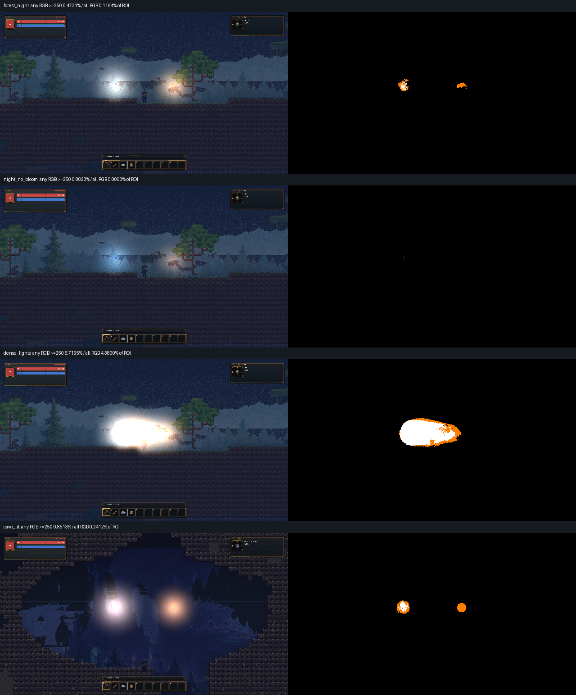

# PR-0C: Rendering & Lighting Diagnostic Baseline

Base: manually integrated PR-0B, `38bea1c00dbedb93c570bf0472c0362746224316`.
Branch: `codex/yjse-p0-003-lighting-diagnostics`; [PR #8](https://github.com/YoungJibbit95/2D-Game-Engine/pull/8).
Frozen runtime/report implementation: `1ecfaaa4369a362001228239505fe2f435ac0d16`.
Date: 2026-10-18. User authorization covers branch/commit/push/PR; no automatic merge.

## Delivered behavior and unchanged reference boundary

PR-0C adds opt-in diagnostics to the published client and existing smoke runner. The original four Golden JSON fixtures, PNGs and sidecars are byte-identical to integrated PR-0B. They remain the before/control references; derived diagnostic captures are observations, not newly approved Golden references. `Game.Core`, `Game.Data`, lighting calculations, renderer architecture, content IDs, persistence and world generation are unchanged.

The current diagnostic code records real CPU invocation samples and per-frame work into bounded, preallocated arrays. Capture/export happens after measured CPU scopes. The existing EMA profiler remains an EMA; the new analyzer calculates arithmetic means and nearest-rank p50/p95/p99 from raw samples, and amortizes scopes over all measured frames including unscheduled zeros. Parent `Frame.Update`/`LightingPrepare` scopes include their children: adding them double-counts work.

The recorder has an isolated exact-zero-allocation regression. Ordinary operation adds only diagnostic counters and named CPU subscopes around existing operations; it uses the same resource owners, light collector, mask builder, hashing, `SetData` and composition path. A null diagnostic option is omitted from fixture serialization, preserving the original Golden scene identity.

## Reproduction and scenarios

From the repository root after locked restore/build/publish, using the same .NET/Python/PowerShell prerequisites as PR-0B:

```powershell
dotnet restore YjsE.sln --locked-mode
dotnet publish Game.Client/Game.Client.csproj -c Release --no-restore -o ../YJsE-PR-0C-publish
./tools/run_golden_scenes.ps1 -PublishRoot ../YJsE-PR-0C-publish -OutputDirectory artifacts/control-goldens
./tools/run_lighting_diagnostics.ps1 -PublishRoot ../YJsE-PR-0C-publish -Width 1920 -Height 1080 -Frames 1800 -WarmupFrames 300 -Repeats 3 -OutputDirectory artifacts/measurements-1080p
./tools/run_lighting_diagnostics.ps1 -PublishRoot ../YJsE-PR-0C-publish -Width 2560 -Height 1440 -Frames 1800 -WarmupFrames 300 -Repeats 3 -OutputDirectory artifacts/measurements-1440p
python tools/summarize_lighting_diagnostics.py --run-root <1080p-GUID-root> --run-root <1440p-GUID-root> --output-dir Docs/Development/Measurements/PR_0C
```

The runner uses the existing `run_client_smokes.ps1` process deadline, fresh output/user roots, strict preload and real backbuffer capture. Environment identity is shared with the Golden runner through `client_capture_environment.ps1`. Each scene repeats in independent processes and must match exact scene metadata and decoded pixels; no tolerant retry is available. Fixture JSON is generated under ignored artifacts from the unchanged source fixture; its source SHA is retained.

| Diagnostic ID | Input / purpose |
| --- | --- |
| `forest_day` | Stationary clear noon, no dynamic sources; sky/AO/preparation and upload-skip baseline |
| `forest_night` | Stationary midnight; two stationary existing Magic/Fire projectile sources |
| `cave_lit` | Stationary Crystal Depths; two stationary sources and cave/occlusion workload |
| `forest_pan` | Night sources; triangular camera X sweep +/-48 world pixels, 240-tick period |
| `forest_zoom` | Night sources; fixed center, zoom 2 +/-0.25 on the same period |
| `cave_panzoom` | Cave sources; both camera and zoom sweeps |
| `dense_lights` | Twelve requested stationary projectiles, **six used** by the existing Medium point-light budget; budget pressure rather than a twelve-used-light claim |
| `night_no_bloom` | Night input with bloom strengths explicitly zero; descriptive quality ablation, not a production correction |
| `core_dirty` | Stationary day; mark the fixed 55 loaded chunks light-dirty every 60 ticks, preserving existing solve/budget rules; bounded invalidation stress, not a claim of representative everyday mining frequency |

Seed 1337, weather clear, fixed clock, default rendering quality 2, fixed preloaded chunks, no autosave/device input/streaming, invulnerable player and disabled autonomous spawning follow the controlled Golden setup. Diagnostic sources have zero velocity; source lifetime covers the complete workload. Rendering still uses one authoritative `GameSimulation`, exactly one 1/60-second tick per presentation step. Frame-limit configuration is 0, VSync/low-latency pacing are disabled, and actual requested presentation interval/cap are recorded. This measures accelerated fixed-workload throughput; it is not real-time gameplay FPS or a GPU benchmark.

Native references use three fresh Release processes per scenario/resolution, 300 warmup plus 1,500 measured frames (54 captures). CI uses two shorter repetitions of all nine scenarios per Windows/Ubuntu Debug/Release cell to check contracts, reproducibility and artifact publication; hosted software-render timings are not native-hardware performance acceptance.

## Measurements and interpretation

The versioned [CSV observations](Measurements/PR_0C/native_runs.csv) and [JSON context/ranges](Measurements/PR_0C/native_summary.json) retain individual process values, actual loaded-binary hashes, source/driver identity, scope distributions, logical upload payloads, Core lighting averages, clipping observations and raw-artifact hashes. Source-coupled Core phase ordinal 14 is `GameSimulationPhase.Lighting` in frozen implementation `1ecfaaa`. Core phases use the existing telemetry and are reset after warmup; snapshot allocation occurs only after the measurement window. Core phase means are arithmetic; per-phase p95 is not inferred from a mean.

All 54 fresh processes passed capture/report contracts; all repeats within each fixture have identical decoded pixels and scene/state metadata. Values below are the **minimum–maximum across three per-process observations**, in milliseconds. Prepare p95 is per invocation; frame p95 is the measured presentation interval. The CSV also retains p99 and amortized costs. These distributions are not interchangeable.

| Resolution | Scenario | Prepare mean | Prepare p95 | Mask CPU mean | Upload CPU mean | Frame p95 | Core Lighting mean |
| --- | --- | --- | --- | --- | --- | --- | --- |
| 1920x1080 | cave_lit | 1.371–2.252 | 2.456–3.920 | 0.671–0.943 | 0.422–0.922 | 3.709–6.250 | 0.100–0.113 |
| 1920x1080 | cave_panzoom | 1.743–2.084 | 3.044–3.918 | 0.718–0.873 | 0.665–0.851 | 4.686–5.766 | 0.095–0.125 |
| 1920x1080 | core_dirty | 0.905–1.102 | 1.182–1.276 | 0.702–0.855 | <0.001 | 3.357–3.697 | 0.249–0.343 |
| 1920x1080 | dense_lights | 1.542–2.255 | 2.595–3.868 | 0.926–1.136 | 0.383–0.806 | 3.692–5.311 | 0.008–0.013 |
| 1920x1080 | forest_day | 0.844–0.919 | 1.200–1.234 | 0.645–0.704 | <0.001 | 2.787–22.670 | 0.009–0.012 |
| 1920x1080 | forest_night | 1.579–1.771 | 2.779–3.251 | 0.789–0.854 | 0.488–0.598 | 4.114–4.577 | 0.009–0.012 |
| 1920x1080 | forest_pan | 1.298–2.649 | 2.210–4.698 | 0.648–0.964 | 0.401–1.309 | 3.287–6.367 | 0.008–0.014 |
| 1920x1080 | forest_zoom | 1.389–1.815 | 2.362–3.481 | 0.680–0.784 | 0.433–0.731 | 3.341–5.064 | 0.007–0.011 |
| 1920x1080 | night_no_bloom | 1.719–1.919 | 3.077–3.447 | 0.821–0.889 | 0.555–0.679 | 4.380–5.137 | 0.011–0.012 |
| 2560x1440 | cave_lit | 1.835–2.152 | 3.319–3.829 | 0.743–0.831 | 0.723–0.914 | 6.065–7.102 | 0.112–0.126 |
| 2560x1440 | cave_panzoom | 1.441–2.476 | 2.744–4.592 | 0.568–0.843 | 0.605–1.224 | 4.395–7.237 | 0.071–0.112 |
| 2560x1440 | core_dirty | 0.861–1.032 | 1.222–1.284 | 0.637–0.775 | <0.001 | 3.217–3.934 | 0.267–0.288 |
| 2560x1440 | dense_lights | 1.931–2.338 | 3.083–4.155 | 0.998–1.066 | 0.587–1.068 | 4.945–5.653 | 0.009–0.011 |
| 2560x1440 | forest_day | 0.843–1.114 | 1.148–1.343 | 0.618–0.837 | <0.001 | 2.893–3.849 | 0.008–0.015 |
| 2560x1440 | forest_night | 1.564–2.007 | 2.808–3.464 | 0.751–0.876 | 0.489–0.763 | 4.261–5.633 | 0.010–0.013 |
| 2560x1440 | forest_pan | 1.785–1.917 | 3.173–3.416 | 0.750–0.834 | 0.699–0.730 | 4.521–5.052 | 0.007–0.010 |
| 2560x1440 | forest_zoom | 1.559–1.744 | 2.765–3.150 | 0.677–0.753 | 0.580–0.671 | 3.786–4.674 | 0.007–0.009 |
| 2560x1440 | night_no_bloom | 1.720–1.860 | 2.963–3.203 | 0.761–0.835 | 0.588–0.666 | 4.557–4.906 | 0.009–0.010 |

The existing Medium budget caps the mask at 6,144 pixels: actual dimensions are **104x58 (6,032 pixels)** at both resolutions. The measurements therefore do not show a resolution-independent high-detail lightfield. Measured zoom/pan creates no texture rebuilds. All runs execute preparation 1,125 times per 1,500 measured frames (the existing 45 Hz cadence against fixed 60 Hz workload). Day still spends roughly 0.85–1.1 ms per prepare even when all post-warmup texture uploads are skipped. This makes dependency-safe preparation reuse a concrete experiment, without assuming it can skip temporal settling or source variation.

Dynamic scenes spend substantial CPU time in both mask construction and `SetData`. Night submits 36,192 logical bytes per measured frame; pan 51,875.2 and zoom/cave panzoom 54,288. These averages include unscheduled frames. The scoped upload call runs even when hash equality skips actual uploads; invocation count is distinct from actual texture-upload count. The day estimate is 217,152 bytes for nine textures; reflection-enabled dynamic scenes reach 289,536 bytes for twelve. Neither is a VRAM measurement.

Repeat variance is material. One 1080p day process has a 22.670 ms frame p95 despite a 1.234 ms preparation p95; the other day frame p95 values are much lower. Its cause is unresolved and is not assigned to GPU, driver, the CPU mask or a 60 FPS limiter. Requested caps are disabled, but this does not prove absence of external pacing or scheduling interference. No refresh-rate guarantee or optimized-versus-current speedup is claimed. Core dirty stress averages 0.249–0.343 ms at 1080p versus 0.009–0.012 ms in day; the higher steady cave Core cost remains a separate diagnostic question.

Actual loaded Release DLL identity is `1.0.0+1ecfaaa4369a362001228239505fe2f435ac0d16`; Client SHA256 `675802DD45E00E2228BDCE517B11D001AC9790119C3B724FF4307F5355B508B1`, Core SHA256 `4E760822446F532999F2356E025547A364A89B371E6F46151F33561C8CD500A4`. Later worktree dirtiness during documentation/export does not change those loaded binaries. Local raw roots are `artifacts/measurements-1080p/9c73c5a6209d47a1a491f9d83a8c33fc` and `artifacts/measurements-1440p/d42e64396b454417ac0c97ec13910dea`; versioned CSV binds each capture, PNG and report by SHA256. Large raw traces stay in smoke artifacts; CI publishes its own complete shorter raw traces and images.

`LightingGpuUpload` is CPU wall time around `Texture2D.SetData` plus bookkeeping. It can include managed/native copies, submission and synchronization waits. The probe cannot partition driver overhead versus waiting, and submitted RGBA8 bytes are logical payload, not measured PCIe traffic. **GPU execution and GPU transfer completion time remain unknown.** No supported, validated timestamp integration is present; see the [technical decision](PR_0C_LIGHTING_DECISION.md).

Triple-buffer texture payload is an estimate (`9 x maskPixels x 4`, or twelve textures with reflections), not measured VRAM. Arrays add approximately 52/56 CPU bytes per mask pixel. Current zoom changes sampling/world coverage rather than texture dimensions; zero measured texture rebuilds during a zoom trace is evidence only for that fixed-viewport workload. Device reset, resize, unload and long residency behavior still need explicit acceptance before a new cache/compositor is introduced.

Process means and p95/p99 ranges describe three observations, not confidence intervals or pooled percentiles. The host is Windows 10.0.26100, Ryzen 5 5500/12 logical processors, RTX 3070 Ti driver 32.0.16.1692, .NET 8.0.28, MonoGame 3.8.4.1. JIT, GC, OS scheduling, other host activity and driver behavior remain sources of variation. Instrumentation and normal presentation resource work are included where their CPU scopes apply; final screenshot readback, image analysis and serialization are outside measured CPU scopes.

## Visible quality and stability evidence

The analyzer emits a clipping heatmap over the middle half of the image, excluding the outer HUD bands. All-RGB/any-RGB values >=250 and display-encoded Rec.709 luma percentiles are descriptive: authored colors, emissive sprites and overlays may contribute. They are neither physical radiance nor an automatic artistic acceptance gate. The bloom ablation isolates a settings input; it does not identify every source of clipping or authorize a visual change.



This preview is reproducibly exported from 1080p repeat zero; original pixels determine all measurements. White means all three channels >=250, orange means at least one, black means neither or outside the ROI. Forest night washes out texture around the white/cyan Magic source. Any-channel ROI clipping drops from **0.4731% to 0.0023%**, and all-channel clipping from **0.1164% to zero**, when diagnostic bloom is disabled. Timing ranges overlap and actual upload counts stay unchanged: this supports investigating bloom's visual contribution, not a performance win or a proven formula correction. Twelve requested/six used sources produce a connected white area obscuring terrain/player detail (**5.7195% any / 4.3800% all**). Cave structure remains readable; bright white/pink and orange source regions and thin cyan horizontal lines are visible. The lines' origin in lighting, background, liquids or composition remains unresolved. Cross-resolution clipping fractions are not directly comparable quality scores because field of view, ROI area and world sampling differ.

The world probe samples the nearest prepared mask cell at fixed position `(anchorX-96, anchorY-24)`, including shadow, RGB and bloom. Probe availability is explicit. Values on unscheduled frames are the displayed prepared field; work counters are zero on those frames. Variation includes light flicker, grid quantization, viewport-dependent sampling and temporal history. It is not automatically classified as a shadow artifact or flicker.

Matched-input probe comparisons bind seed, settings/content, source configuration, resolution/window and ticks, excluding the intentional camera-path difference. Different diagnostic scene IDs also name different worlds; world names participate in the authoritative state hash. These comparisons therefore explicitly record that complete authoritative-state equivalence is **not** hash-proven. They are configured-input observations rather than causal proof of a quality defect. Repeated runs of each identical fixture do enforce exact state/hash/image identity.

Default and long benchmark endpoints return to the camera anchor, so a final PNG alone cannot prove spatial stability throughout the sweep. Twenty additional fresh-process captures cover five static/moving fixtures at ticks 300 and 420, with 120 warmup frames: all ten exact pairs pass. Sidecars confirm +48/-48 world-pixel pan and zoom 2.25/1.75. Visual inspection finds coherent terrain/player/light translation, a fixed HUD, no detached halo, missing tile column, black flash or obvious new seam at those extrema. Existing washout and cave lines persist. Local checkpoint root is `artifacts/visual-checkpoints`; reproduce with the diagnostic runner's `-Frames 300` and `-Frames 420 -WarmupFrames 120` (the full runner also covers the other four scenarios). Fixed-world nearest-cell probes differ across paths by up to 0.0485 shadow, 0.0466 blue and 0.0449 bloom, including quantization/history effects; this does not prove flicker. Endpoint inspection cannot exclude brief shimmer or trails. Full-field temporal analysis and occluded-torch/sloped-tile/unload fixtures remain future acceptance work. No claim that all cave/shadow artifacts are resolved belongs in PR-0C.

## Validation, review and next slice

| Gate | Current evidence |
| --- | --- |
| Clean base | PR-0B merged at 38bea1c; locked restore/Release zero-warning build and 1,731 base ordinary tests pass |
| Original four before references | Four exact fresh-process pairs plus exact versioned-reference comparisons pass before instrumentation |
| C# fixture/raw recorder contracts | 16 focused cases pass, including existing eight Golden cases and eight new diagnostic cases |
| Allocation gates | Three isolated Facts pass locally in Debug and Release, preserving exact 0 B assertions and original warmups |
| Python analysis | 21 diagnostic and 13 existing image-comparison regressions pass; shortened/missing/invalid measurements fail |
| Frozen long captures | 54/54 pass report contracts and repeated exact images/state; 20 additional extrema captures form ten exact pairs |
| Final Debug/Release | Local locked restore, zero-warning builds and 1,738 ordinary tests per configuration pass; style verification passes |
| Existing local gates | All 21 isolated Release timing classes/39 tests and quick harness pass; strict main/Wave05 audits have zero hard issues; unchanged UI/Wave05 previews and seven preview regressions pass |
| Native control smokes after instrumentation | Original four fresh-process pairs and all four exact versioned-reference comparisons pass; ordinary Main Menu, World Select and Playing published Release smokes pass (263 resources / 1,518 frame descriptors) |
| Hosted implementation matrix | [Push run 39112516623](https://github.com/YoungJibbit95/2D-Game-Engine/actions/runs/39112516623) passes all five jobs at 1ecfaaa: Website and Windows/Ubuntu Debug/Release, 1,738 ordinary + three strict allocation tests per cell; unchanged 21 Release timing classes/39 tests per OS; original smokes/Goldens and nine diagnostic pairs per cell |
| Downloaded hosted evidence | All four functional TRX files confirm 1,738/1,738; all 72 diagnostic reports are valid, 36 repeated comparisons exact; sixteen original Golden pairs exact and sixteen portable reference comparisons accepted. Software-render timing is not substituted for native GPU performance |
| External CI interruption | PR run 39112521637 initially stopped Ubuntu Release during pip installation with `ConnectionResetError(104)` before tests. One failed-job rerun passes the complete job ([attempt 2](https://github.com/YoungJibbit95/2D-Game-Engine/actions/runs/39112521637/attempts/2)); the other four jobs passed first attempt. No test retry, skipped gate or relaxed threshold was introduced. Final documentation-head checks remain required |

Two genuine subagents owned independent cost/architecture review; separate file ownership was used for the Python analyzer and decision document. The lead integrated, executed builds/tests/captures and owns final acceptance. Review corrected empty optional scopes, missing window/scope validation, stale skipped-frame counters and probe availability before frozen measurement capture.

Final independent source and visual reviews found no blocking regressions. Local gate log is `artifacts/final-local-gates.log`; final native control root is `artifacts/final-local/golden-scenes/14cf5c9ea03d4f38a67936f552bf4915`. The separate original checkout remains on `main` at `164795ae`; latest read-only inventory observes 102 tracked modifications and 219 untracked files, differing from the historical initial inventory as other work continues there. PR-0C neither edits nor resets that checkout.

The [decision document](PR_0C_LIGHTING_DECISION.md) compares incremental work, chunk RGB and simplified GPU composition, including resources, dirty regions and migration risk. Candidate performance remains unknown; no candidate prototype or rendering replacement is shipped. Preferred next slice: transient light-output/geometry version contracts plus bounded, pixel-preserving preparation reuse, with matched uncapped measurements and explicit invalidation tests. Do not skip based on `NeedsLightUpdate == false`, which is a scheduling flag rather than an output revision. RGB/save/hash migration and production composition changes require separate decisions and reviewed visual references.

Rollback: revert PR-0C commits; diagnostics remain opt-in. Human review/manual integration only. No automatic merge, reference replacement or automatic Renderer/Lighting/Worldgen V2 rollout.
